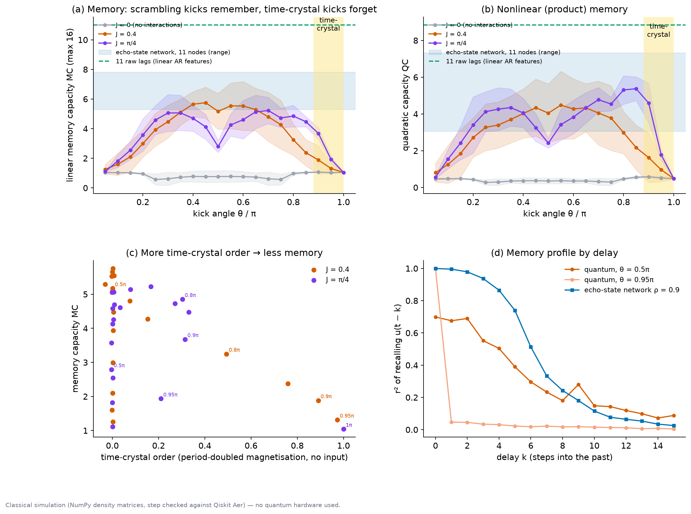
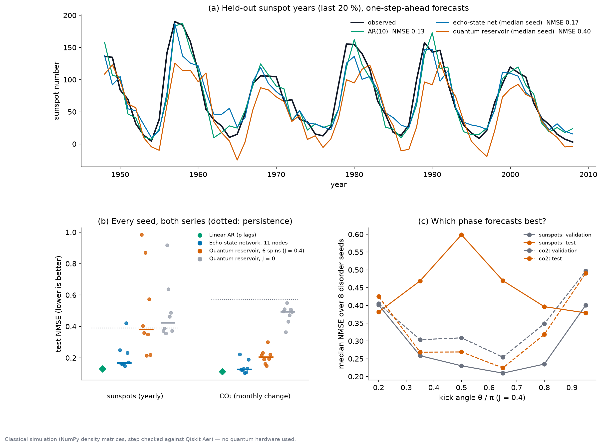
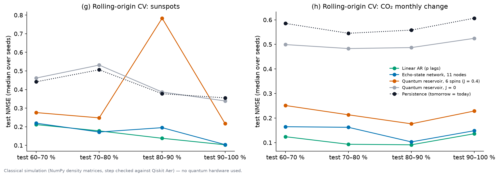
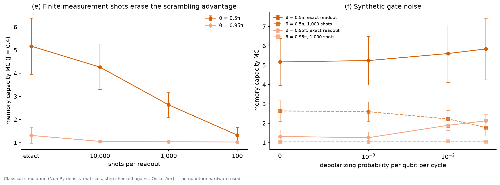
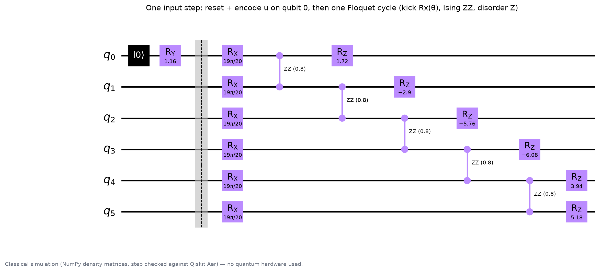

# Does a time crystal make a better quantum memory?

**Qiskit Fall Fest 2026 Warsaw · Track 2: Quantum machine learning** · Wyatt Reisz ([@wdreisz](https://github.com/wdreisz))

A disordered kicked-Ising (Floquet) spin chain used as a quantum reservoir computer, benchmarked against an echo-state network, linear autoregression and persistence on two real time series. All models get the same features, splits and readout.

> **Classical simulation only.** Everything runs on a laptop: exact NumPy density matrices for 6 qubits, with one reservoir step cross-checked against Qiskit Aer's density-matrix simulator. Shot noise and gate noise are simulated. No quantum hardware and no IBM account were used. **We claim no quantum advantage.**

## The question

Discrete time crystals (θ near π, interactions J ≠ 0) are the most robust phase a periodically kicked spin chain can have. Does that robustness make a better *memory* for quantum reservoir computing than a scrambling regime? And does any phase of the quantum reservoir beat simple classical models on real data when the comparison is fair?

## The answer

- **Time-crystal order hurts memory.** It freezes the spins: the chain flips back and forth and the injected input barely spreads. The scrambling regime (θ around π/2) reaches memory comparable to an 11-node echo-state network. The time crystal (θ near π) stays close to the trivial value, as does the non-interacting control (J = 0) at every θ. Across the scan, memory capacity anti-correlates with time-crystal order.
- **On real forecasting, classical models win.** Linear AR is best on both series and the ESN is second. The quantum reservoir is third. On CO2 it is much better than its J = 0 control and than persistence. On the main sunspot split it is only about as good as persistence and sensitive to the disorder seed, and the kick angle that wins on validation does not win on test. Rolling-origin cross-validation keeps the same AR > ESN > quantum order on both series.
- **Measurement is the hardware bottleneck.** With finite shots the scrambling regime's memory collapses. The time crystal is shot-robust only because it has almost no memory to lose. On a device, every readout destroys the state, so the input sequence would need to be re-run up to each readout time.

The exact numbers are in [Results](#results). They are generated from `artifacts/*.json` and are not typed by hand.









## How it works



| Piece | What it does |
|---|---|
| **Reservoir** | 6 spins in an open chain. Each input step resets qubit 0 to √(1−u)\|0⟩ + √u\|1⟩ (Fujii & Nakajima 2017), then applies 2 Floquet cycles U_F = e^(−i Σ h_i Z_i) e^(−i J Σ Z_i Z_{i+1}) Π R_x(θ), with disorder h_i ~ U[−π, π] drawn per seed. |
| **Phases** | θ ≈ π with J ≠ 0 is the time crystal (period-doubled magnetisation). θ ≈ π/2 gives scrambling kicks. Small θ barely mixes. J = 0 is the non-interacting control. |
| **Readout** | ⟨Z_i⟩ (6) and ⟨Z_i Z_{i+1}⟩ (5) = 11 features → ridge regression. Only the readout is trained. |
| **Simulation** | Exact density matrices (64 × 64) in NumPy, with optional multinomial shot sampling and local depolarizing noise per qubit per cycle. `tests/` checks one step against Qiskit Aer's density-matrix simulator. |
| **E1 memory** | i.i.d. uniform input; memory capacity MC = Σ_k r² for recalling u(t−k), k = 0…15, plus quadratic capacity. 20 kick angles × J ∈ {0, 0.4, π/4} × 1 and 2 cycles per step × 5 disorder seeds. A period-doubling order parameter is measured on the same chain without input. |
| **E2 forecasting** | One-step-ahead forecasts on yearly sunspots (1700–2008) and the monthly change of Mauna Loa CO2 (1958–2001). Both ship with statsmodels, so no download is needed. |
| **E3 robustness** | Exact readout vs 10,000 / 1,000 / 100 shots, and depolarizing noise up to p = 0.03, for θ = 0.5π and 0.95π. Hardware restart cost. |
| **E4 cross-validation** | Rolling-origin folds: the test block moves forward and every model is re-tuned on its own preceding validation block. |

## Fair benchmark checklist (Track 2 brief)

| The brief asks for | What we do |
|---|---|
| A real dataset, kept small | Two public series with 309 and 525 values, bundled with statsmodels. |
| Same features for every model | Quantum reservoir and ESN both give 11 features to the same ridge readout. AR uses at most 11 lags. The J = 0 quantum control uses the same 11 features. |
| Same train/test split for every model | Time-ordered train 65 % / validation 15 % / test 20 %, identical for all models. The series is min–max scaled on the training block, not clipped, and a test checks that scaling uses the training block only. The quantum encoder clamps its input to [0, 1]. |
| Cross-validation | All hyperparameters (θ, ridge α, ESN spectral radius and input scale, AR order) are chosen on validation only, refitted on train + validation, then tested once. Every stochastic model runs over 8 disorder/random seeds. A rolling-origin cross-validation repeats the whole protocol on several forward-moving test blocks. |
| Show where the classical model wins | Per-seed Diebold–Mariano tests against AR and the ESN, the full ranking with persistence, and the section below. |

## Where the classical model wins

Everywhere we looked on forecasting. Both series are close to linear-autoregressive: sunspots have an ~11-year cycle and CO2 changes a 12-month cycle. An AR model whose order is chosen on validation captures that directly, while the best quantum phase remembers only a handful of steps (see E1 below). An 11-node echo-state network has the same feature count and at least as much memory, and it runs in microseconds. The quantum reservoir's one clear result is relative to its own control: interactions matter, because the J = 0 chain is far worse on CO2.

On memory capacity alone, the best scrambling phase sits inside the ESN range but below its top. A plain delay line of 11 lags has the most memory of all.

## Results

<!-- RESULTS:START -->
*Generated by `presentation/build.py` from `artifacts/*.json`; do not edit by hand.*

### Memory capacity (E1, i.i.d. input, mean over seeds)

| Reservoir | Memory capacity |
|---|---:|
| Quantum, scrambling peak (θ = 0.45π, J = 0.4) | 5.75 |
| Quantum, time crystal (θ = 0.95π, J = 0.4; order 0.97) | 1.32 |
| Quantum, J = 0 control (all θ) | 0.57–1.07 |
| Echo-state network, 11 nodes (range over ρ and seeds) | 5.31–7.82 |
| 11 raw lags (linear delay line) | 11.00 |

Memory capacity is at least 5 for θ = 0.35π–0.65π (J = 0.4). Across the J ∈ {0.4, π/4} scan it anti-correlates with time-crystal order (r = -0.51).

### One-step forecasting (E2, test block, median over 8 seeds, NMSE, lower is better)

| Model | Sunspots | CO2 |
|---|---:|---:|
| Linear AR (p lags) | 0.131 | 0.112 |
| Echo-state network, 11 tanh nodes | 0.167 [0.15–0.42] | 0.128 [0.10–0.22] |
| Quantum reservoir, 6 spins (J = 0.4) | 0.381 [0.21–0.98] | 0.205 [0.15–0.30] |
| Persistence (next = current) | 0.391 | 0.572 |
| Quantum reservoir, J = 0 (no interactions) | 0.425 [0.36–0.92] | 0.493 [0.36–0.55] |

[min–max over seeds]. Diebold–Mariano tests on the test block, per seed, p < 0.05:

| Series | AR significantly better than quantum | ESN significantly better than quantum | Quantum beats AR | ESN beats AR |
|---|---:|---:|---:|---:|
| Sunspots (yearly) | 7 / 8 | 6 / 8 | 0 / 8 | 0 / 8 |
| Mauna Loa CO2 (monthly change) | 7 / 8 | 5 / 8 | 0 / 8 | 2 / 8 |

Phase choice: the kick angle with the lowest median validation NMSE is θ = 0.65π on sunspots, but the lowest median test NMSE is at θ = 0.95π. On CO2 both are θ = 0.65π (test 0.65π). Per-seed choices on sunspots: 0.5π ×2, 0.65π ×4, 0.8π ×2.

### Rolling-origin cross-validation (4 folds)

Test blocks: 60–70 %, 70–80 %, 80–90 %, 90–100 % of each series; every fold re-tunes all models on its own preceding validation block.

**Sunspots (yearly)**, 4 rolling-origin folds

| Model | Median test NMSE over folds | Mean rank | Folds won |
|---|---:|---:|---:|
| Linear AR (p lags) | 0.158 | 1.25 | 3 |
| Echo-state network, 11 tanh nodes | 0.183 | 1.75 | 1 |
| Quantum reservoir, 6 spins (J = 0.4) | 0.262 | 3.5 | 0 |
| Persistence (next = current) | 0.410 | 4 | 0 |
| Quantum reservoir, J = 0 (no interactions) | 0.424 | 4.5 | 0 |

**Mauna Loa CO2 (monthly change)**, 4 rolling-origin folds

| Model | Median test NMSE over folds | Mean rank | Folds won |
|---|---:|---:|---:|
| Linear AR (p lags) | 0.109 | 1 | 4 |
| Echo-state network, 11 tanh nodes | 0.155 | 2 | 0 |
| Quantum reservoir, 6 spins (J = 0.4) | 0.221 | 3 | 0 |
| Quantum reservoir, J = 0 (no interactions) | 0.493 | 4 | 0 |
| Persistence (next = current) | 0.572 | 5 | 0 |

- sunspots, 4 folds: mean-rank order AR > ESN > Quantum reservoir > Persistence > J = 0 control; quantum reservoir mean rank 3.5 of 5, best in 0 of 4 folds.
- CO2, 4 folds: mean-rank order AR > ESN > Quantum reservoir > J = 0 control > Persistence; quantum reservoir mean rank 3 of 5, best in 0 of 4 folds.

Rolling-origin cross-validation (4 folds) keeps the AR > ESN > quantum order on both series by mean rank. In those folds the quantum reservoir beats persistence on sunspots in median (0.26 vs 0.41) but is worse in 1 of 4 folds.

### Shots, noise and hardware cost (E3)

| Readout | Memory capacity, θ = 0.5π | Memory capacity, θ = 0.95π |
|---|---:|---:|
| exact | 5.17 | 1.32 |
| 10,000 shots | 4.27 | 1.06 |
| 1,000 shots | 2.64 | 1.04 |
| 100 shots | 1.33 | 1.03 |

Synthetic depolarizing noise (θ = 0.5π, p per qubit per cycle from 0 to 0.03): memory capacity goes 5.17 → 5.84 with exact readout, and 2.64 → 1.77 at 1,000 shots.

Hardware restart cost: a projective readout destroys the state, so the input sequence is re-run up to each readout time. For the 309-step sunspot series that is 95,790 Floquet cycles per shot instead of 618 for a single pass (155×), and 309,000 circuit runs at 1,000 shots per readout. The E2 protocol (6 angles × 8 seeds × 2 series) would need about 40 million circuit runs.
<!-- RESULTS:END -->

## Prior work, and what is new here

The idea is **not new**, and we do not pitch it as the first time-crystal reservoir. Zhang et al., *Robust and Efficient Quantum Reservoir Computing with Discrete Time Crystal*, arXiv:2508.15230 (2025), use essentially the same model: imperfect π kicks, random ZZ and Z fields, reset-and-inject input and ⟨Z⟩/⟨ZZ⟩ readout. They map memory, parity and NARMA10 across the MBL, thermal and time-crystal phases, find the phase boundaries best, and run classification on superconducting hardware. Martínez-Peña et al. (PRL 2021) found the thermal phase and the thermalisation transition best for a static disordered Ising reservoir. Fujii & Nakajima (2017) introduced quantum reservoir computing and the input scheme. Mujal et al. (2023) analysed the measurement and restart cost of time-series QRC.

This project is an **independent replication and extension**:

1. **Real time series** (sunspots, CO2) instead of synthetic tasks only.
2. **Matched classical baselines:** an ESN with the same feature count and readout, linear AR, persistence, and a J = 0 quantum control, all tuned on validation only.
3. **Forecasting vs memory phase choice:** the phase with the most memory and the phase that forecasts best need not match, and on sunspots the validation choice does not hold on test.
4. **Measurement cost:** shot noise per phase and the restart bill of projective readout.

Our results agree with the prior picture: deep in the time-crystal phase the reservoir is a poor memory. Notes and links are in [docs/literature.md](docs/literature.md).

## Reproduce

Requires Python 3.12.

```bash
python -m venv .venv
source .venv/bin/activate
pip install -r requirements.lock.txt
pip install -e .

python -m qreservoir.experiments     # E1–E4 -> artifacts/*.json (~90 s on a laptop)
python -m qreservoir.figures         # figures/*.png and artifacts/summary.json
pytest                               # 10 correctness tests, incl. the Qiskit Aer cross-check
streamlit run app/app.py             # interactive explorer
jupyter notebook notebooks/floquet_reservoir.ipynb   # walkthrough
python presentation/build.py         # deck.html, deck.pdf, docs/*.md and the README results block
```

Open `presentation/deck.html` in any browser. It is one self-contained file with the figures embedded; use the arrow keys or click to move between slides. `presentation/deck.pdf` is the same deck, printed by headless Chrome. `build.py` refuses to write output if a placeholder, `nan`, `inf` or `None` survives, or if a qualitative claim in the slides (for example "AR is best on both series") no longer matches the data.

## Repository layout

```
src/qreservoir/
  reservoir.py      exact density-matrix Floquet reservoir (shots, depolarizing noise), echo-state network, lags
  circuit.py        the same reservoir step as a Qiskit circuit (cross-check and circuit figure)
  tasks.py          memory capacity, series loading, time-ordered splits, train-only scaling, ridge readout, Diebold–Mariano
  experiments.py    E1 phase scan, E2 forecasting, E3 shots/noise, E4 rolling-origin CV -> artifacts/*.json
  figures.py        figures and artifacts/summary.json from the JSON
tests/              10 tests: physicality, unitarity, reset, Qiskit Aer match, shots, splits, DM sign
artifacts/          results JSON with provenance (versions, timestamp, platform) and run.log
figures/            PNG + SVG figures
presentation/       build.py and the generated deck.html, deck.pdf
docs/               literature.md; generated abstract.md, pitch.md, qa.md, submission.md
app/                Streamlit explorer
notebooks/          walkthrough notebook
```

## Limitations

- **Simulation only.** Six qubits, exact density matrices, and a synthetic noise model. No device calibration and no error mitigation.
- **Small data.** Two univariate series and one-step-ahead forecasts only. The sunspot validation block is short (one to two solar cycles), so phase choice there is noisy.
- **Small grids.** Six kick angles for forecasting, one coupling (J = 0.4) for E2/E3, two cycles per step, and small ESN and ridge grids. Other couplings, chain lengths or input encodings could behave differently.
- **One readout.** ⟨Z⟩ and nearest-neighbour ⟨ZZ⟩ with a linear readout. Richer observables or nonlinear readouts were not tried.
- **Multiple comparisons.** Diebold–Mariano tests are reported per seed, without correction.
- **Literature scan.** The novelty check in `docs/literature.md` was short. A closer prior result could exist.

## Honesty statement

Every result here comes from classical simulation on a laptop; no quantum hardware was used. We claim no quantum advantage: the classical baselines win the forecasting benchmark, and we report that directly. The model is not original; it follows Zhang et al. (2025), and we present it as a replication and extension. All numbers in this README's Results section, the deck and the docs are generated from the saved JSON by `presentation/build.py`.

## Licence

MIT. See [LICENSE](LICENSE). © 2026 Wyatt Reisz.
